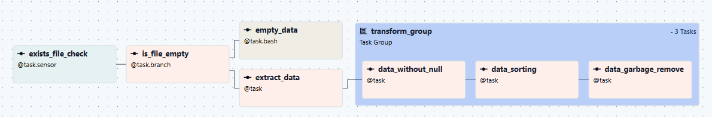
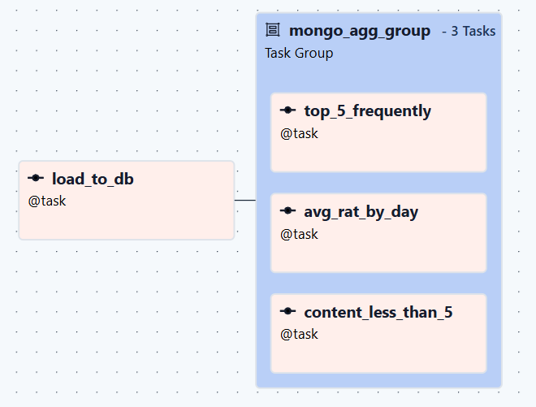
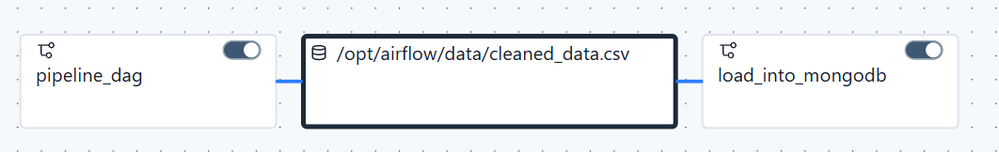
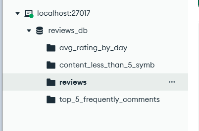
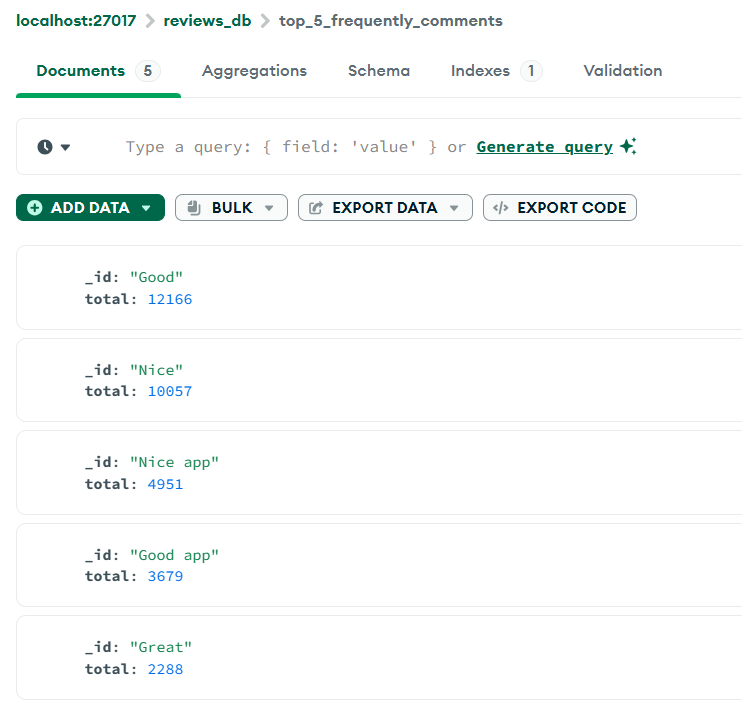
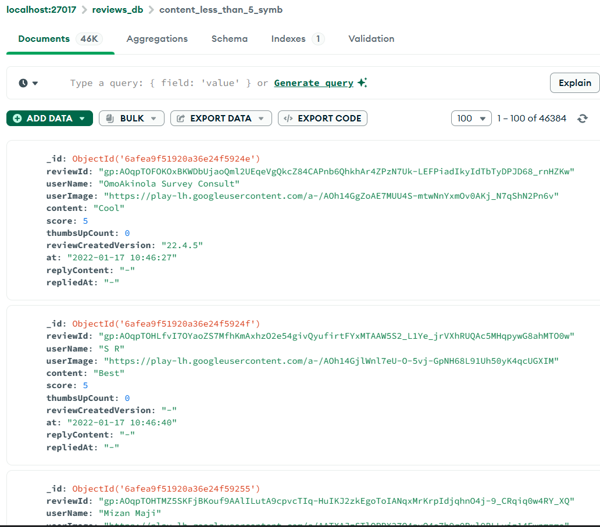
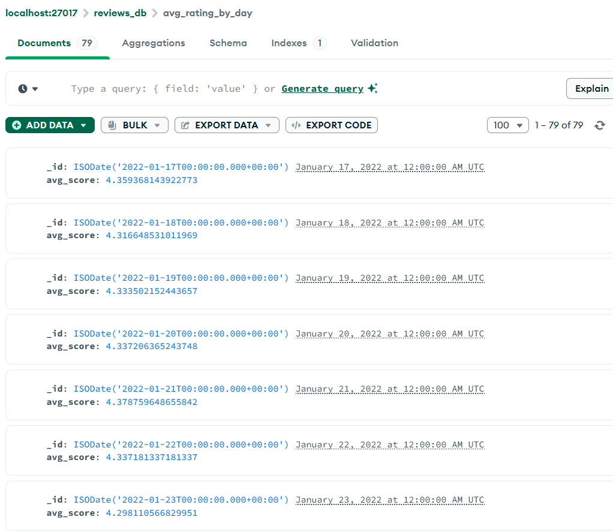

# Airflow & MongoDB ETL Pipeline

This project implements an automated ETL (Extract, Transform, Load) pipeline using **Apache Airflow**, **Pandas**, and **MongoDB**. The pipeline extracts data from a ZIP archive, performs data cleaning and transformation, loads it into MongoDB, and runs analytical aggregations.

## Features

* **Data Extraction**: Automates extraction of CSV files from ZIP archives using Airflow Sensors.

* **Data Transformation (Pandas)**: Cleans data by handling `NaN`/`null` values, sorting, and removing unnecessary data garbage. Uses intermediate Parquet files for faster I/O.

* **Data Loading (MongoDB)**: Inserts the cleaned dataset into a MongoDB collection.

* **Analytical Aggregations**: Uses native MongoDB Aggregation Pipelines to create three analytical data marts:

  1. `top_5_frequently_comments`: Top 5 most frequent comments.

  2. `content_less_than_5_symb`: Raw reviews where the content length is strictly less than 5 characters.

  3. `avg_rating_by_day`: Average daily rating, grouped by `ISODate` timestamp.

## Tech Stack

* **Orchestration**: Apache Airflow (TaskFlow API, Task Groups, Assets for cross-DAG dependencies)

* **Database**: MongoDB (via `pymongo`)

* **Data Processing**: Python, Pandas

* **Infrastructure**: Docker & Docker Compose

## How to Start

### 1. Prerequisites

Make sure you have [Docker](https://www.docker.com/) and [Docker Compose](https://docs.docker.com/compose/) installed on your machine.

### 2. Download the Dataset

Download the raw data archive (`archive.zip`) from this link:
[Download Dataset (Google Drive)](https://drive.google.com/file/d/1crEUrJMn3XI4ukzlTN8r0ZAzdOVYhpNq/view)

Place the downloaded archive into the `data/` folder in the root of the project:

```text
project_root/
├── dags/
├── utils/
├── data/
│   └── archive.zip     <-- Place it here
└── docker-compose.yaml
```

### 3. Configuration

Make sure to specify the correct path to your input archive in the configuration file `utils/config.py`:

```python
# utils/config.py
from pathlib import Path
PATH = Path("data/archive.zip") 
```

### 4. Run the Infrastructure

Start Airflow and MongoDB via Docker Compose:

```bash
docker compose up -d
```

Airflow Web UI will be available at: `http://localhost:8080`.


### 5. Run the Pipelines

Unpause the DAGs in the Airflow UI.

* The `pipeline_dag` will detect the archive, process it, and output a cleaned CSV.

* The `load_into_mongodb` DAG is triggered automatically (via Airflow Assets) once the cleaned file is ready, loading data into MongoDB and running the aggregation task group.

## Results & Screenshots


### Airflow DAG Execution

**1. Extract & Transform DAG (`pipeline_dag`)**



**2. Load & Aggregate DAG (`load_into_mongodb`)**



**3. Asset-Driven Scheduling**



### MongoDB Aggregation Results

**1. Database & Collections Structure (`reviews_db`)**



**2. Top 5 Most Frequent Comments**



**3. Reviews with Content Length < 5 Characters**



**4. Average Daily Rating (`ISODate`)**




### Troubleshooting

**MongoDB connection is missing in Airflow?**
Normally, the connection is created automatically during the initialization phase. However, if you experience database connection timeouts or don't see the `mongodb` connection in the Airflow UI, you can add it manually:

1. Go to Airflow UI -> **Admin** -> **Connections** -> **+ Add a new record**.
2. Set the following values:
   - **Connection Id**: `mongodb`
   - **Connection Type**: `Generic`
   - **Host**: `mongodb`
   - **Login**: `admin`
   - **Password**: `secret`
   - **Port**: `27017`
   - **Schema**: `reviews_db`
   - **Extra**: `{"authSource": "admin"}`
3. Save the connection and unpause the DAG again.
